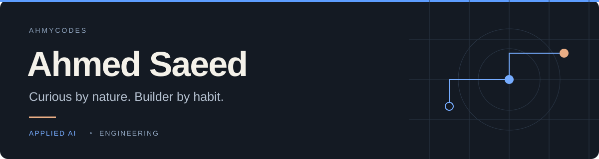

  

### Applied AI Lead · Office of the CEO · SharkNinja

Hey, I'm Ahmed. I build internal products and automations with the teams who use them. Usually that starts with a conversation about something taking too long, a process that keeps breaking, or an idea worth trying.

I like getting into the details, building the first version, and sticking around to make it work in practice. That's the part of forward deployed engineering I enjoy most.

 

<table>
<tr>
<td width="33%" valign="top">
<strong>Build useful things</strong>  
AI products, internal tools, and automations that make someone's day easier.
</td>
<td width="33%" valign="top">
<strong>Stay close to the work</strong>  
Understand the problem with the people living it. Keep improving after the first release.
</td>
<td width="33%" valign="top">
<strong>Keep asking questions</strong>  
Try things early. Learn what holds up. Change what doesn't.
</td>
</tr>
</table>

 

Before applied AI, I worked on software quality for Shark's robot vacuums and smart home products. I studied Computer Science at UMass Amherst. Both taught me to look past the demo and ask what happens when someone actually uses the thing.

**Often working with** Python · JavaScript · React · SQL

Away from the keyboard, I'm usually looking for a hiking trail, playing football, or planning the next trip.

[Let's connect on LinkedIn ↗](https://www.linkedin.com/in/ahmsae/)
